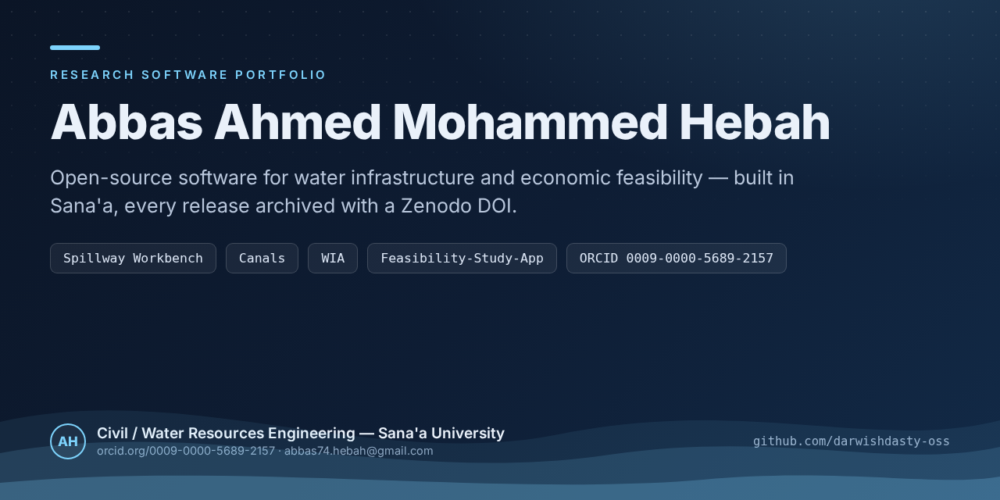

# Abbas Ahmed Mohammed Hebah

Civil / Water Resources Engineering · Sana'a University

I build open-source research software for water infrastructure and economic
analysis — designed for reproducibility, Arabic-first where it matters, and
usable offline where connectivity is unreliable.

---

## Research Software Portfolio

Every tool is open source (MIT) and every release is archived with a Zenodo DOI.

| Tool | What it does | Stack | Cite |
|------|--------------|-------|------|
| [**Spillway Workbench (SWB)**](https://github.com/darwishdasty-oss/spillway-workbench) | Cross-platform Python reimplementation of the USBR cavitation programs — spillway design, cavitation analysis, flood routing | Python |  |
| [**Canals**](https://github.com/darwishdasty-oss/Canals-) | Open-channel hydraulic design workbench for irrigation canals — dimensioning, flow checks, reproducible reports | Python |  |
| [**WIA — Water Impact Assessment**](https://github.com/darwishdasty-oss/wia-water-impact-assessment) | Bilingual (AR/EN), offline-first Android app for criteria-based impact assessment of water infrastructure projects | Flutter |  |
| [**Feasibility-Study-App**](https://github.com/darwishdasty-oss/feasibility-study-app) | Arabic-first web app for economic feasibility studies — NPV, IRR, MIRR, WACC, Monte Carlo, sensitivity analysis | Next.js |  |

### Related research artifacts

- **Cavicuspill** — integrated calculation software for cavitation analysis,
  flood routing, and spillway design in open-channel hydraulic structures
  ([DOI 10.5281/zenodo.22817893](https://doi.org/10.5281/zenodo.22817893))
- Verification datasets for 3-D VOF (OpenFOAM) Ogee-spillway studies:
  cavitation-number fields, wave-overtopping benchmarks, pressure signatures.

## Interests

Reproducible hydraulic engineering · open-source scientific software ·
Arabic-language UX for technical tools · Monte Carlo methods in engineering economics
